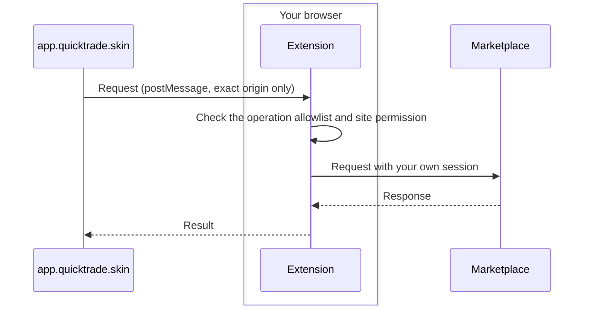

<p align="center">
  <a href="https://quicktrade.skin">
    
  </a>
</p>
<h1 align="center">QuickTrade.skin browser extension</h1>
<p align="center">One dashboard for CS2 sellers: list, reprice and remove listings across marketplaces from one tab.</p>

<p align="center">
  <a href="https://chromewebstore.google.com/detail/quicktradeskin/clfbmigopfeojlpeejifcielhngijbpg"></a>
  <a href="https://chromewebstore.google.com/detail/quicktradeskin/clfbmigopfeojlpeejifcielhngijbpg"></a>
  <a href="https://chromewebstore.google.com/detail/quicktradeskin/clfbmigopfeojlpeejifcielhngijbpg"></a>
  <a href="https://addons.mozilla.org/firefox/addon/quicktrade-skin/"></a>
  <a href="https://addons.mozilla.org/firefox/addon/quicktrade-skin/"></a>
  <a href="https://addons.mozilla.org/firefox/addon/quicktrade-skin/"></a>
  <a href="https://github.com/BHORC-Trading-CO/quicktrade-extension/actions/workflows/ci.yml"></a>
  <a href="LICENSE"></a>
</p>

<p align="center">
  <a href="https://chromewebstore.google.com/detail/quicktradeskin/clfbmigopfeojlpeejifcielhngijbpg"></a>
  <a href="https://addons.mozilla.org/firefox/addon/quicktrade-skin/"></a>
</p>

The extension connects the web app at [app.quicktrade.skin](https://app.quicktrade.skin) to the CS2 marketplaces you are already signed in to. It works in Chrome and other Chromium browsers (Edge, Opera, Brave) and in Firefox 140+.

## What it does

- **List on several marketplaces at once**: pick an item, set a price per marketplace, publish; edit prices and remove listings from the same screen.
- **Scheduled repricing**: price changes you set up run on their own, also while the app tab is closed.
- **Instant-sell quotes**: compare what instant-sell sites pay for an item or the whole inventory.
- **Sale history and competitors**: recent sales and competing listings of the same item next to your price.
- **Your inventory** from Steam and the marketplaces in one list.

Every listing, price change and purchase is one you asked for. QuickTrade.skin is not a trading bot and has no gambling features.

## How it works



Marketplace cookies and sessions stay in your browser: requests go from your browser straight to the marketplace, and QuickTrade.skin never sees your passwords. You choose which marketplaces the extension may access.

## About this repository

This repository is a source snapshot of the extension, exported from the private QuickTrade.skin monorepo for each release. It lets anyone audit what the extension does and rebuild the release archives byte for byte (see [BUILD.md](BUILD.md)). The web app and the server are not public.

## Permissions and data

- `storage` and `unlimitedStorage` keep scheduler rules, marketplace state and the local diagnostic journal.
- `scripting` restores the bridge in already-open application tabs after extension activation.
- `cookies` reads marketplace session data for approved requests; sensitive authentication values remain in the extension background.
- `alarms` runs scheduled work while the application tab is closed.
- `declarativeNetRequest` and `declarativeNetRequestWithHostAccess` manage request header rules. Page-supplied rules are restricted to requests initiated by this extension.
- Install-time host access covers the application, cs.money, CSFloat and Steam Community. This revision declares optional HTTPS access broadly; runtime connection requests are restricted to the bundled marketplace catalog and require a user gesture. Firefox uses `optional_permissions` for these hosts.

The toolbar button grants a pending marketplace permission or opens the application. There is no popup. Firefox requires version 140 or newer and declares authentication information and website content in its data consent metadata. Chrome requires version 101 or newer.

## Web communication

A content script accepts the application's `postMessage` messages and relays them to the background through extension runtime messaging. Production accepts the exact `https://app.quicktrade.skin` origin, excludes `/api/*`, and does not inject into marketplace pages. Development builds also permit localhost. The background validates message shape, the bundled operation allowlist and granted host permissions before sending a marketplace request. Some operations can buy, list or change prices when the user enables those features.

A signed operation table can update endpoint definitions within enforced limits. Its verification public key, the Chrome identity public key, and the Firefox add-on identifier are intentionally public. A failed or expired table falls back to bundled operations. Marketplace sessions and tokens are not build inputs.

## Build and verify

Use Node 22.17.1 and npm 10.9.2. From the repository root:

```sh
npm ci
npm test
npm run build
npm run zip
```

Both browser builds and their manifests are checked. See [BUILD.md](BUILD.md) for the precise unsigned payload comparison and AMO source instructions. [CONTRIBUTING.md](CONTRIBUTING.md) explains the test workflow; report security concerns privately as described in [SECURITY.md](SECURITY.md).

## Support

- Help and FAQ: [app.quicktrade.skin/faq](https://app.quicktrade.skin/faq)
- Email: [support@quicktrade.skin](mailto:support@quicktrade.skin)
- Security issues: privately, as described in [SECURITY.md](SECURITY.md), never in a public issue

## License

The source is available under the [Functional Source License 1.1, Apache 2.0 Future License](LICENSE) (FSL-1.1-ALv2). You may read, audit, run, modify and redistribute it for any purpose except a competing use: offering it, or a product built on it, as a commercial substitute for QuickTrade.skin. Two years after each version is published, that version is also available under the Apache License 2.0. Snapshots published before the license change (up to and including 1.13.1) remain available under the Apache License 2.0.

The license covers this source code only. It does not grant access to the QuickTrade.skin service or its server, or rights to the QuickTrade names or logos. See [NOTICE](NOTICE).

## Disclaimer

QuickTrade.skin is not affiliated with Valve or with any marketplace. Counter-Strike 2 and Steam are trademarks of Valve Corporation; marketplace names and logos belong to their owners.
